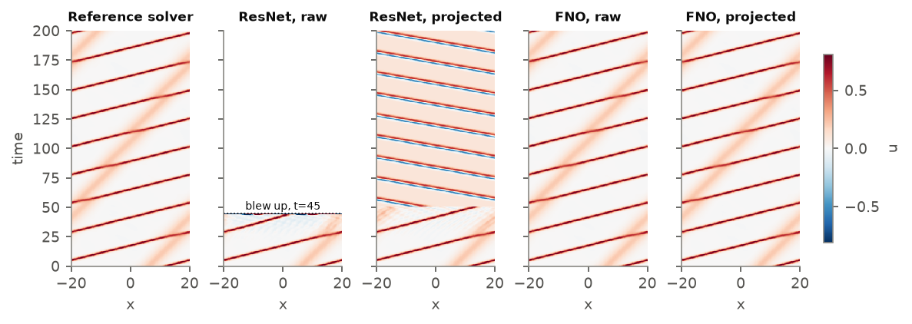

# Noether Check

[](https://github.com/PS12007/noether-check/actions/workflows/tests.yml)

**Neural PDE surrogates break conservation laws. That is both why their long rollouts fail and how you can tell that they have.**

Neural surrogates for physics are trained and ranked on one-step error, then rolled out for hundreds of steps on their own predictions. This project trains a controlled zoo of surrogates (FNO, ResNet, U-Net; two sizes; input-noise and soft-penalty variants; several seeds) on two systems with known conservation laws, KdV solitons and decaying 2D turbulence, and asks three questions:

1. **Ranking.** Does one-step error predict how a model behaves over long rollouts?
2. **Repair.** If after every step we make the *smallest* change to the state that restores some conserved quantities (a *Noether projection*), how much does that help?
3. **Alarm.** Can the conserved quantities we did *not* restore tell, without the true solution, that a rollout has gone wrong?

- 📄 **Technical report:** [docs/noether-check.pdf](docs/noether-check.pdf) ([HTML](https://ps12007.github.io/noether-check/paper.html))
- 🧪 **Interactive demo:** [ps12007.github.io/noether-check](https://ps12007.github.io/noether-check/). Scrub through precomputed rollouts of each model, raw and projected, next to the reference solver, and watch the unprojected invariant spike when a rollout fails.



## Key results

64 surrogates: 36 on KdV (12 configurations × 3 seeds) and 28 on 2D turbulence.

| Finding | Number |
|---|---|
| Spearman correlation of one-step error with error at the end of the rollout (KdV step 400 / turbulence step 100) | **−0.22 / −0.48** |
| ...with error at step 10 (KdV) | 0.93 |
| ResNets: lowest one-step error on both systems, yet share of test rollouts that blow up (KdV step 400 / turbulence step 100) | 66% / 43% |
| KdV: median long-horizon error after projecting mass + momentum (step 400; helps all 36 models) | **−64%** |
| KdV: drift of energy, which is *never* projected, after projecting the other two | **8× lower** |
| KdV: models whose median rollout blows up, raw → projected | 24% → 2% |
| Turbulence: error at step 100 after imposing the energy budget (median ratio; U-Net 9.0 → 1.7) | **0.54×** |
| Turbulence: energy-spectrum error at step 100, raw → projected (FNO / U-Net; holding the initial state fixed gives 1.36) | 1.26 → **0.36** / 2.94 → **1.00** |
| KdV early warning: AUROC at step 200 for "will fail by step 400", held-out energy drift vs. disagreement with a twin model | **0.94** vs 0.87 |
| Turbulence: AUROC for "rollout is unphysical" at step 100, held-out enstrophy budget vs. twin model (projected) | **0.98** vs 0.65 |

## Results to read carefully

- **Projection cannot fix what it cannot see.** The turbulence ResNets fail through a grid-scale checkerboard that carries enstrophy but almost no energy, so an energy constraint leaves them blowing up (43% → 39%). On KdV, projection only delays the ResNets (126 → 176 valid steps).
- **Projecting more looks better and is worse.** Imposing the enstrophy budget too removes every ResNet blow-up and improves pointwise error, but leaves energy spectra off by about four orders of magnitude per shell, and no invariant is left to warn you.
- **Out of distribution, projection keeps rollouts bounded but wrong.** On KdV random fields every model fails from the first step. Projection prevents most blow-ups (94% finite vs 22%) but raises the error where both are finite, and it removes the most obvious failure signal, so the held-out drift has to take over.
- **For pointwise error in chaotic flow, the twin model is the better monitor.** Before step 20, while some turbulence rollouts are still accurate, disagreement with a second model beats the budgets (AUROC 0.90–0.99 vs 0.77–0.93). The budgets win on the failure that matters later: unphysical states.
- **Early warning in turbulence starts late.** At step 10 nothing predicts which rollouts will turn unphysical. From step 50, the enstrophy budget does (0.85–0.89).
- **The usual training fixes are not universal.** Input noise rescues the KdV ResNet but nearly doubles the long-horizon error of the FNO and U-Net. A soft invariant penalty changes nothing on KdV and makes turbulence worse.
- **Smaller study on turbulence.** 28 models, with one to three seeds per configuration, because a laptop memory limit stopped the full run.

## How it works

| Piece | File |
|---|---|
| Reference solvers: KdV (ETDRK4, Kassam–Trefethen contour integrals) and 2D Navier–Stokes (RK4 with integrating factor), batched on the GPU, plus their invariants and budgets | [`noether/solvers.py`](noether/solvers.py) |
| Surrogates: FNO, periodic ResNet, U-Net, all in residual form | [`noether/models.py`](noether/models.py) |
| Noether projection: Gauss–Newton minimum-norm correction δ = Jᵀ(JJᵀ)⁻¹(c − I(u)) | [`noether/project.py`](noether/project.py) |
| Label-free drift monitor (invariant drift, budget residuals) | [`noether/monitor.py`](noether/monitor.py) |
| Training and rollouts | [`noether/train.py`](noether/train.py) |
| Model zoo, evaluation, summaries, monitor study, spectra, figures | [`experiments/`](experiments) |

## Run it

```bash
pip install -r requirements.txt     # plus a CUDA build of PyTorch for speed
sh run_all.sh                       # data, zoo, analyses, figures; resumable
python -m pytest tests -q           # fast CPU checks of solvers, projection and models
```

Everything is generated locally: the reference data (~0.5 GB in `data/`, not committed) come from the solvers in this repo, so nothing is downloaded. On a laptop RTX 5060 the KdV zoo takes about 2 hours and the turbulence zoo about 3.

## Repository layout

```
noether/        solvers, models, projection, monitor, training, statistics
experiments/    make_data, zoo, summarize, monitor_eval, spectra, export, figures, paper_tables
results/        per-model JSON results and summaries (small, committed)
docs/           paper (HTML + PDF), demo page, figures, demo data
tests/          CPU unit tests
```

*Built autonomously by Claude Code as a research exercise; every number in the report is produced by the code in this repository.*
